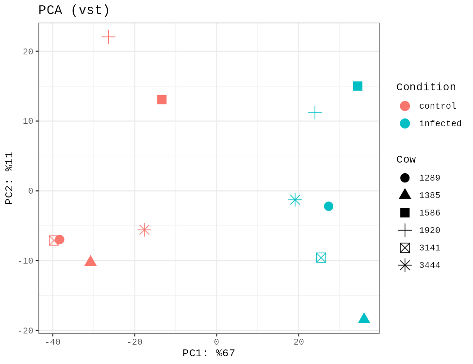
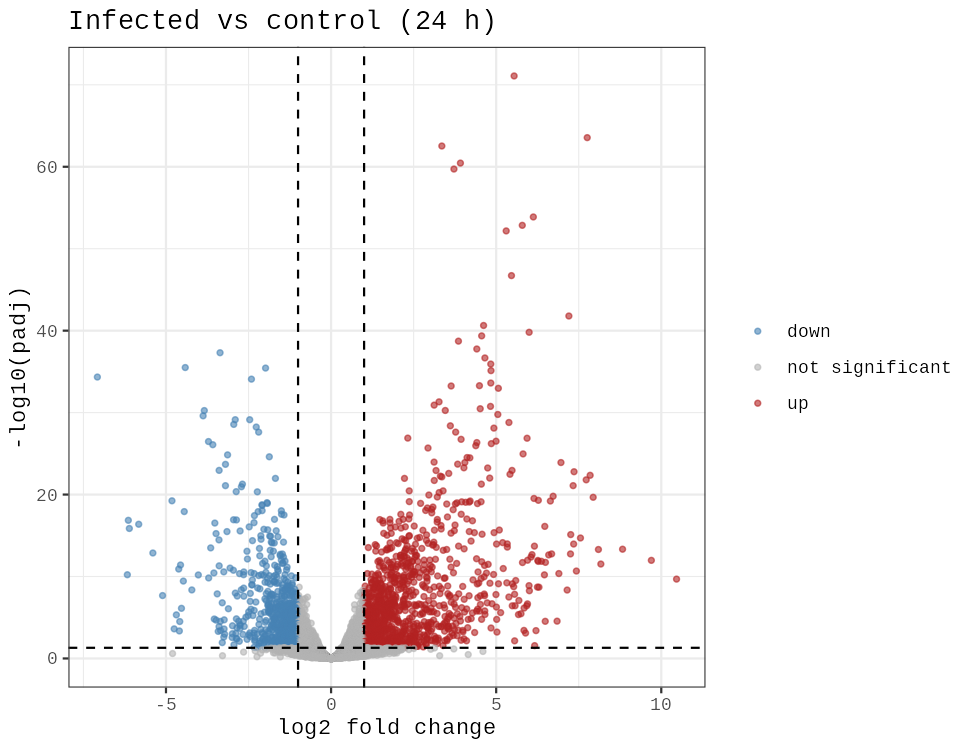
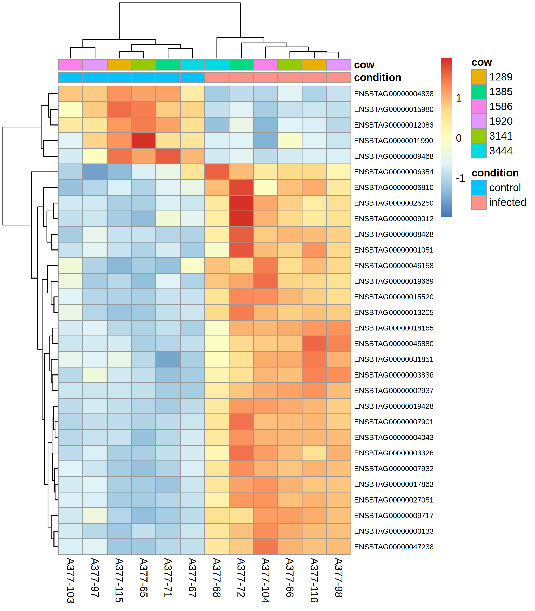

# Sığır mastitinde E. coli enfeksiyonu: meme dokusunda diferansiyel gen ifadesi (RNA-seq)

Bu projede herkese açık bir RNA-seq veri setinden (GEO: **GSE75379**) yola çıkarak, E. coli ile enfekte edilmiş sığır meme çeyreği ile aynı ineğin enfekte edilmemiş çeyreği arasındaki gen ifadesi farkı **DESeq2** ile incelendi. Kalite kontrol için **FastQC** ve **Trimmomatic** kullanıldı.

## Özet

- Karşılaştırma: enfeksiyondan 24 saat sonra, 6 ineğin enfekte (sol ön çeyrek) ve kontrol (sağ ön çeyrek) meme dokusu, toplam 12 örnek, eşleştirilmiş tasarım.
- 14.369 gen teste girdi. **3.826 gen** anlamlı farklı (padj < 0,05). En az 2 kat değişim şartıyla (|log2FC| ≥ 1) **1.931 gen**: 1.236 artan, 695 azalan.
- Artan genler bağışıklık hücreleri ve akut faz yanıtıyla, azalan genler süt yağı sentezi ve lipit metabolizmasıyla ilişkili.
- Ham veri kalite kontrolü (FastQC, Trimmomatic) bir test örneğinde yapıldı. İfade analizi yazarların yayımladığı sayım tablosundan yapıldı (ayrıntılar aşağıda).

## Veri

| | |
|---|---|
| Kaynak | GEO GSE75379 (SRA: SRP066638, BioProject: PRJNA304027) |
| Tür / doku | *Bos taurus*, meme dokusu (biyopsi) |
| Deney | Canlı *E. coli* ile kontrollü enfeksiyon; enfekte çeyrek ve aynı ineğin enfekte edilmeyen çeyreği |
| Teknoloji | Illumina HiSeq 2000, 100 bp paired-end, TruSeq mRNA kütüphanesi |
| Kullanılan alt küme | 24. saat, meme dokusu, 6 inek (1289, 1385, 1586, 1920, 3141, 3444) = 12 örnek |

Örnek listesi: [`metadata/udder_24h_metadata.csv`](metadata/udder_24h_metadata.csv). Enfekte örnekler sol ön çeyrek (VF), kontroller sağ ön çeyrek (HF) kaynaklıdır. Veri setinde 192. saatte yalnızca kontrol örnekleri bulunduğu için o zaman noktası kullanılmadı.

## Yöntem

### 1. Veri indirme
SRA Toolkit (`prefetch`, `fasterq-dump`) ile FASTQ dosyaları indirildi. Bir test örneği (SRR2960032, inek 3141, enfekte çeyrek, 25.250.142 okuma çifti) baştan sona işlendi.

### 2. Kalite kontrol (FastQC ve Trimmomatic)
- **FastQC (ham veri):** Okuma uzunluğu 101 bp, düşük kaliteli dizi yok, GC %49. Adapter Content uyarı verdi: okumaların sonuna doğru adaptör oranı okuma 1'de yaklaşık %5, okuma 2'de yaklaşık %3. Aşırı temsil edilen en sık üç dizi TruSeq adaptörü ve PCR primeri idi (okuma 1'in toplam yaklaşık %9'u).
- **Trimmomatic 0.39:** `ILLUMINACLIP:TruSeq3-PE-2.fa:2:30:10:2:True LEADING:3 TRAILING:3 SLIDINGWINDOW:4:15 MINLEN:36`. Sonuç: 25.250.142 çiftin %82,73'ü (20.889.433) iki ucuyla, %4,43'ü yalnızca ileri, %1,08'i yalnızca geri okuma olarak kaldı, %11,76'sı elendi. Süre: 17,2 dakika.
- **FastQC (temizlenmiş veri):** Adapter Content iki okumada da PASS.
- Raporlar: `results/fastqc_raw/`, `results/fastqc_trimmed/`, `results/trim_logs/`.

### 3. Diferansiyel ifade analizi (DESeq2)
- Girdi: yazarların GEO'da yayımladığı sayım tablosu (`GSE75379_count.txt.gz`; GEO örnek kayıtlarına göre okumalar UMD3.1 sığır genomuna Rsubread ile hizalanmış ve gen sayımı Ensembl gen anotasyonuyla featureCounts ile yapılmış). Tablo, tam sayı kontrolünden geçti (ham sayım).
- Hazırlık: [`scripts/01_prepare_inputs.py`](scripts/01_prepare_inputs.py)
- Analiz: [`scripts/02_deseq2.R`](scripts/02_deseq2.R)
- Düşük sayımlı genler elendi (en az 3 örnekte ≥ 10 okuma).
- Model: `~ inek + durum` (aynı ineğin iki çeyreği eşleştirildi), karşılaştırma: enfekte / kontrol. p değerleri Benjamini-Hochberg ile düzeltildi. log2 kat değişimleri büzülmeden (shrinkage uygulanmadan) raporlandı.
- Yazılım sürümleri: `results/deseq2/sessionInfo.txt`.

## Sonuçlar



PCA'da birinci bileşen (varyansın %67'si) kontrol ve enfekte örnekleri tamamen ayırıyor.





Isı haritasında en anlamlı 30 gen, örnekleri iki gruba (kontrol, enfekte) ayıran bir desen oluşturuyor.

### Öne çıkan genler

| Gen | log2FC | padj | İlişkili olduğu süreç |
|---|---|---|---|
| CXCR1 | 8,10 | 5,0e-14 | Kemokin (IL-8) reseptörü |
| CSF3R | 7,94 | 2,1e-20 | G-CSF reseptörü, nötrofil |
| S100A9 | 7,26 | 7,7e-16 | Nötrofil kaynaklı yangı proteini |
| SAA2 | 7,36 | 1,6e-23 | Akut faz proteini |
| HP (haptoglobin) | 5,46 | 1,9e-47 | Akut faz proteini |
| CCR1 | 6,13 | 1,3e-54 | Kemokin reseptörü |
| CD68 | 3,92 | 3,6e-61 | Makrofaj belirteci |
| CD163 | 3,35 | 2,9e-63 | Makrofaj belirteci |
| FASN | -4,42 | 3,2e-36 | Yağ asidi sentezi |
| LPL | -4,02 | 6,4e-11 | Lipit metabolizması |
| BTN1A1 | -3,88 | 2,5e-30 | Süt yağı salgılanması |
| THRSP | -4,61 | 1,2e-11 | Lipogenez |

Tüm sonuçlar: `results/deseq2/deseq2_results_all.csv`, anlamlı genler (gen adlarıyla): `results/deseq2/deseq2_significant_annotated.csv`. Gen adları Ensembl REST ile eklendi, eski kimliklerin bir kısmı için ad bulunamadı (`symbol` sütunu boş).

### Yorum
Artan genler enfekte dokuya nötrofil ve makrofaj gibi bağışıklık hücrelerinin girişiyle ve akut faz yanıtıyla uyumlu. Süt yağı sentezi genlerindeki düşüş, enfeksiyonda meme dokusunun süt üretme işlevinin azalmasıyla uyumlu. Ölçüm tüm doku üzerinden yapıldığı için artışların bir kısmı genlerin hücre içi aktivasyonundan çok doku bileşimindeki değişimi (hücre göçü) yansıtıyor olabilir.

## Sınırlamalar

- **Çeyrek konumu ile enfeksiyon karışmış durumda:** Enfekte örneklerin hepsi sol ön, kontrollerin hepsi sağ ön çeyrekten. Bu tasarımla enfeksiyonun etkisi çeyrek konumundan ayrıştırılamaz.
- **Küçük örnek sayısı:** 6 inek, tek zaman noktası (24. saat).
- **Kalite kontrol tek örnekte:** FastQC ve Trimmomatic yalnızca bir test örneğine (SRR2960032) uygulandı. Kalan örnekler kendi hattımızla işlenmedi.
- **Sayım tablosu yazarlara ait:** Hizalama ve sayım UMD3.1 sürümüyle yazarlar tarafından yapıldı. Salmon ile kendi miktarlamamızı kurmaya başladık, ancak tamamlanmadığı için sonuçlarda kullanılmadı.
- Pathway/zenginleştirme analizi yapılmadı.

## Depo yapısı

```
README.md
samples.csv                      # seçilen 8 örneğin SRA listesi (test hattı)
metadata/udder_24h_metadata.csv  # DESeq2'de kullanılan 12 örnek
scripts/01_prepare_inputs.py
scripts/02_deseq2.R
notebooks/analiz_temiz.ipynb     # Colab defteri (indirme, FastQC, Trimmomatic, DESeq2), baştan sona çalıştırılabilir
results/fastqc_raw/ , results/fastqc_trimmed/ , results/trim_logs/
results/deseq2/                  # tablolar ve grafikler
docs/analiz_adimlari.md          # hücre hücre açıklama (yeni başlayanlar için)
```
Ham veri (FASTQ, SRA) ve sayım tablosu depoya konmadı; GEO'dan GSE75379 numarasıyla indirilebilir.

## Veri kaynağı

GEO: GSE75379, Sørensen P. ve ark. (Aarhus Üniversitesi). Veri herkese açıktır.
